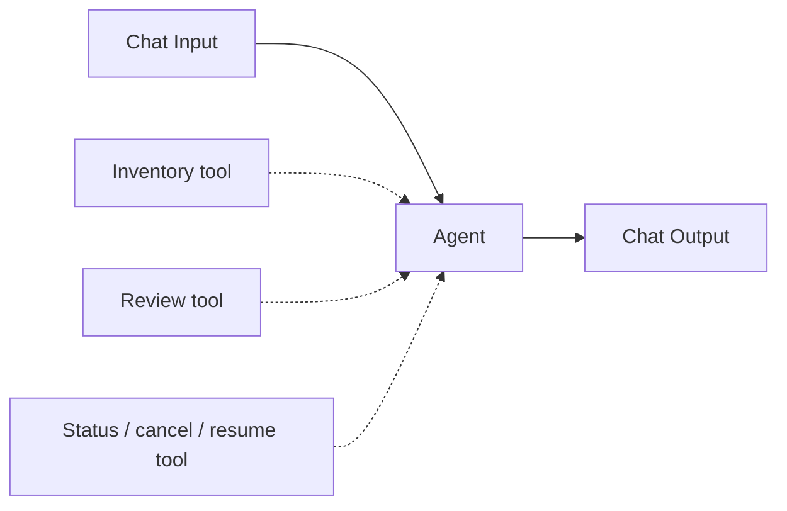

# Incoming Wire Review Demo

A local Langflow learning project that reads an incoming-wire test sheet and PDF evidence, extracts page-cited facts, applies explicit reviewer criteria and writes a separate draft workbook.

All included customers, accounts, documents and rules are fictional. Outputs require human review. This project does not move money, conduct sanctions screening or approve compliance.



## Try the workflow without an API key

Use Python 3.11 in a virtual environment:

```powershell
python -m venv .venv
.\.venv\Scripts\Activate.ps1
python -m pip install -r requirements.txt
python -m reusable_lab.demo
python -m reusable_lab.evaluation --offline --output evaluation-results.json
```

The offline demo reads two fictional samples and writes an XLSX under `reusable_lab/outputs/`. It uses an explicitly labeled deterministic fixture parser, with zero model calls. It demonstrates the workbook/evidence workflow; it does not demonstrate model accuracy. One fixture intentionally has missing evidence and remains OPEN.

## Run it in Langflow

The exported six-node flow was exercised with Langflow 1.2.0 and Python 3.11 on Windows. The compatibility pin is for reproducing that local flow, not a recommendation to expose this version as a public server. A current Langflow version may need component migration and fresh tests.

```powershell
python -m pip install -r requirements-langflow.txt
.\start_langflow.ps1
```

Open `http://127.0.0.1:7860`, import `Langflow_Fictional_Demo.json`, and configure your own OpenAI connection privately in Agent, Reusable Wire Review and Reusable Wire Job. No key is shipped. Keep the server bound to localhost. In Playground, begin a new chat and supply the absolute paths to the included fictional XLSX, its `evidence` folder and `fictional_2026_rules.json`. Set samples to `ALPHA-17,OMEGA-3`. See [the demonstration walkthrough](PORTFOLIO_WALKTHROUGH.md).

The live flow uses an OpenAI model and incurs your provider's charges. Do not enable it until you have configured and approved that connection. Native-text PDFs work without Tesseract. Image-only PDFs require an existing local English Tesseract installation; set `IWT_OCR_DIR` to its directory if it is not on PATH. Missing OCR is reported as unavailable evidence.

## New local batch

Use the exact absolute XLSX and PDF-folder paths, selected sample IDs, applicable rules JSON and an optional explicit mapping. The reader recursively pairs sample documents and inventories missing/ambiguous files first. Limits are 20 selected samples and 160 PDF pages per run. Results are X (supported under selected rules), dash (not applicable with a reason), or OPEN (review needed). The input workbook's previous marks are never evidence.

The saved flow returns a background job ID. Use `status JOBID`, `cancel JOBID`, or `resume JOBID`. Playground Stop does not cancel a background job. Cancellation waits for any current extraction call. There is one active job and at most two extraction workers.

The portable XLSX backend preserves unrequested XML, original styles and unrelated ZIP parts. It does not calculate formulas or render previews. The original local build also has an artifact-tool writer; that proprietary runtime is not required or shipped here.

## Evaluation

The evaluator reports expected-label agreement, field agreement, citation validity, false supported checks and abstention/coverage separately. Developer-authored fictional labels are regression references, not independently validated real-world accuracy. A real-data accuracy claim requires independently reviewed, source-bound expected labels. No real wire records, model caches, private test sheets, company identifiers, credentials or runtime databases belong in this repository.

When included, `EVALUATION_SUMMARY.json` preserves the initial live result and the later source-guard replay separately. Cases inspected to fix a defect become regression cases; the replay is not an untouched holdout or a new model run.

## Copilot Studio and SharePoint

[Copilot Studio build guide](reusable_lab/cloud/COPILOT_BUILD_GUIDE.md) describes the tenant workflow and required backend. The Langflow JSON is not a Power Platform solution. The optional read-only Graph staging adapter needs an independently configured, already authorized company connection; cloud authentication and deployment have not been performed by this package.

## Project map

- `Langflow_Fictional_Demo.json`: importable flow without credentials.
- `components/reusable_wire/`: inventory, background review and job-control tools.
- `reusable_lab/`: PDF/OCR, fact validation, criteria, jobs and preserving XLSX writer.
- `reusable_lab/test_fixtures/`: fictional workbook, PDFs and date-scoped demo rules.
- `reusable_lab/evaluation/`: frozen synthetic cases and evaluation instructions.
- `.github/workflows/checks.yml`: offline checks; no API key is required.

Share this repository as code and a reproducible local demonstration. GitHub does not itself host or run the Langflow agent. Run an approved hosted deployment separately if you later need a browser-only live demo.
